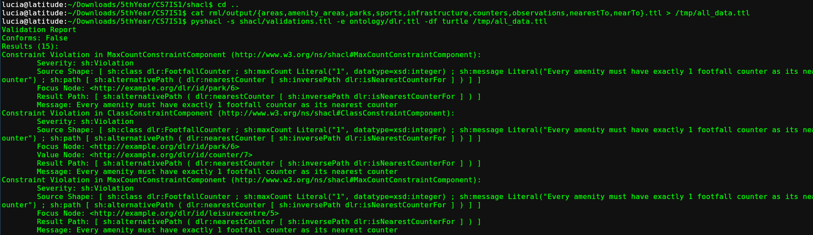
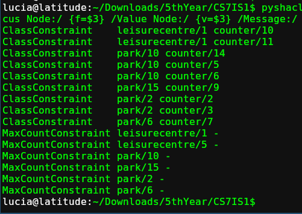
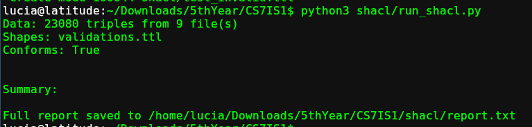

### Create at least 3 instance validations w/ SHACL
shacl/validations.ttl  

_Validation 1: Validates that all the classes are correctly structured_  
_Validation 2: Validates that instances of FootfallObservations have exactly one recordedBy property, and that property is an instance of FootfallCounter. Validates that instances of FootfallObservations have exactly one observedAt property and that property is a datetime value_  
_Validation 3: Validates that every amenity has only one FootfallCounter considered as its nearestTo counter (real error in ontology!)_ 

Validation 2 caught a **real** issue in the ontology on 2 Nov 2026 - see terminal SHACL running instructions  

#### SHACL Running Instructions (Linux Terminal & python3):
**Create concatenated file of the data**: 
`cat rml/output/{areas,amenity_areas,parks,sports,infrastructure,counters,observations,nearestTo,nearTo}.ttl > /tmp/all_data.ttl` 

**Get a full SHACL report**: 
`pyshacl -s shacl/validations.ttl -e ontology/dlr.ttl -df turtle /tmp/all_data.ttl` 

**Simplified view (one line per violation)**: 
`pyshacl -s shacl/validations.ttl -e ontology/dlr.ttl -df turtle /tmp/all_data.ttl | awk '/^Constraint Violation/ {c=$4; sub(/Component.*/,"",c)} /Focus Node:/ {f=$3} /Value Node:/ {v=$3} /Message:/ {printf "%-18s %-30s %s\n", c, f, (v==""?"-":v); v=""}' | sed 's#<http://example.org/dlr/id/##g; s#>##g' | sort`

Modifications were made on the basis of the SHACL failures to correct the ontology:

Ontology is now compliant as of 6 Nov 2026

