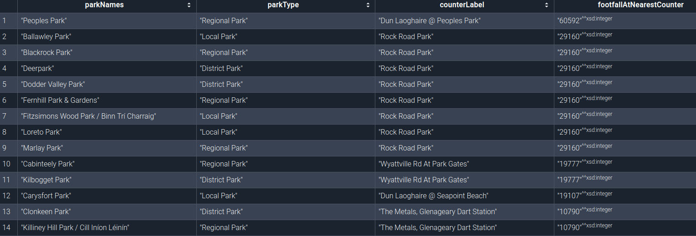
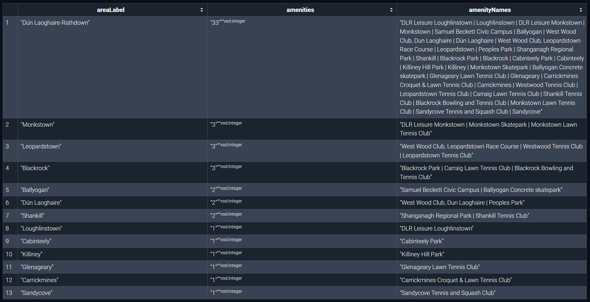
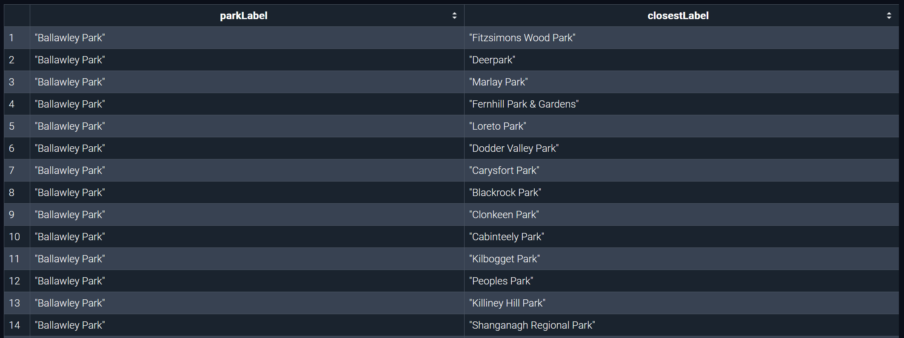
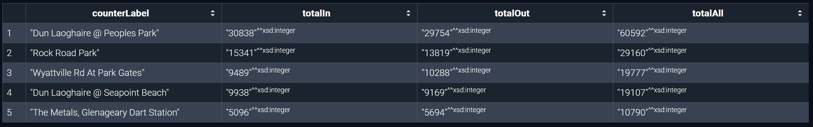
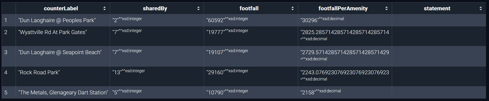
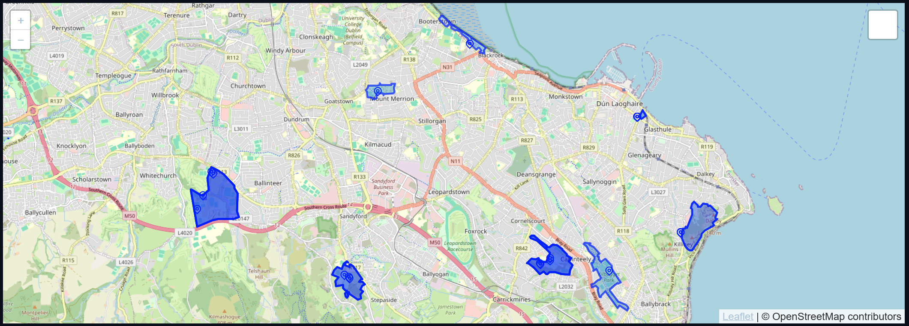
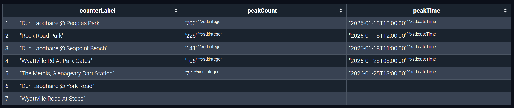

### Create at least 7 queries on the data w/ SPARQL
DYLAN  
_Query 1 (Lucia): sparql/footfallAtEachPark.rq - The entire footfall at each park, based on the nearest footfall counter_
  
_Query 2: sparql/amenitiesPerArea.rq - Amenities in each area + sub areas_  

_Query 3: sparql/closestParksToPark.rq - Each park's neighbouring parks in order of distance_  
(Example for a single park)

_Query 4: sparql/counterInOutTotals.rq - All time in, out and total counts per footfall counter_  

_Query 5: sparql/footfallSplit.rq - A counter's footfall divided between the amenities it is nearest to_  

_Query 6: sparql/infrastructureInsidePark.rq - Infrastructure located inside each park (w/ geosparql)_  

_Query 7: sparql/peakHourPerCounter.rq - the busiest hour each counter recorded_  

